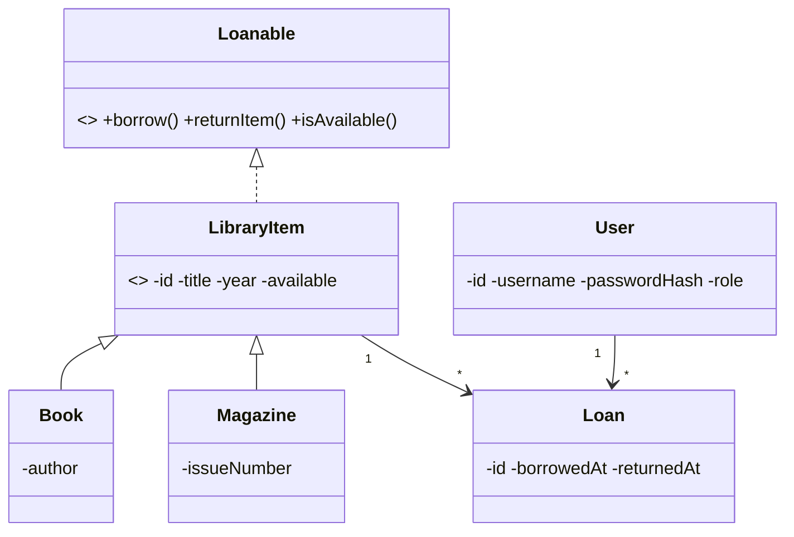
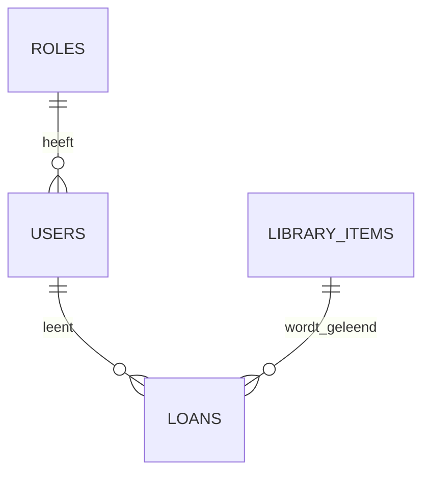
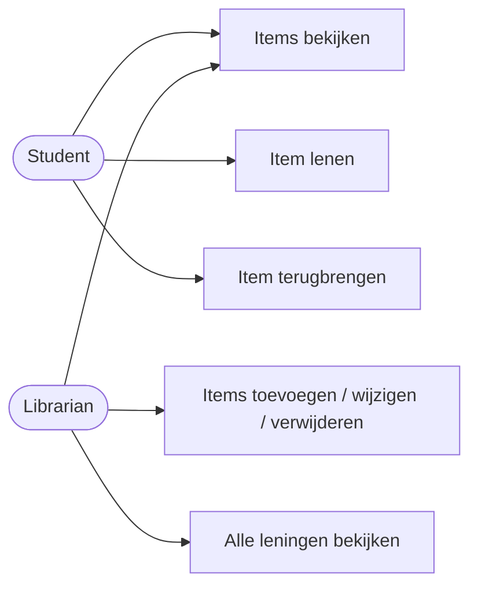
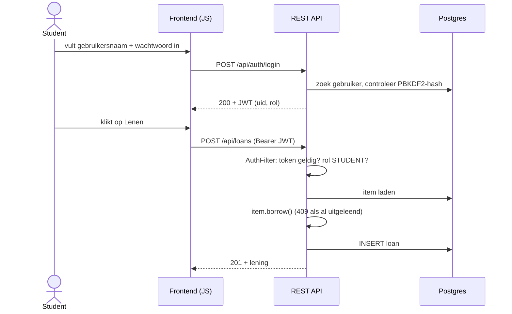

# Library Management System (mini-project)

Java (Jersey/JAX-RS) REST API met JWT en rollen, Postgres, en een frontend in plain HTML/CSS/JS.

> **Let op:** deze code is geschreven zonder dat ik hem kon compileren of draaien. Draai `mvn test` en
> `mvn package` zelf en los eventuele fouten op. Dat hoort bij het project.

## Starten

1. **Database**
   ```
   createdb library
   psql -d library -f db/schema.sql
   ```
2. **Instellingen** (environment variables, standaard alleen geschikt voor lokaal):
   | Variabele | Standaard | Doel |
   |---|---|---|
   | `DB_URL` | `jdbc:postgresql://localhost:5432/library` | database |
   | `DB_USER` | `postgres` | database-gebruiker |
   | `DB_PASSWORD` | `postgres` | database-wachtwoord |
   | `JWT_SECRET` | dev-waarde | geheim voor JWT (min. 32 tekens, op productie verplicht aan te passen) |
3. **Bouwen:** `mvn package` geeft `target/library.war`.
4. **Draaien:** kopieer de war naar `{Tomcat}/webapps` (Tomcat 10.1) en open `http://localhost:8080/library/`.

Demo-accounts: `student1 / student123` en `librarian1 / librarian123`.

## Endpoints

| Methode | Pad | Rol | Doel |
|---|---|---|---|
| POST | /api/auth/login | iedereen | inloggen, geeft JWT |
| GET | /api/items | ingelogd | alle items |
| GET | /api/items/{id} | ingelogd | één item |
| POST | /api/items | LIBRARIAN | item toevoegen |
| PUT | /api/items/{id} | LIBRARIAN | item wijzigen |
| DELETE | /api/items/{id} | LIBRARIAN | item verwijderen |
| POST | /api/loans | STUDENT | item lenen |
| PUT | /api/loans/{id}/return | STUDENT (eigen lening) | terugbrengen |
| GET | /api/loans | ingelogd | student: eigen leningen, librarian: alle |

Voorbeeld met curl:
```
curl -X POST http://localhost:8080/library/api/auth/login -H "Content-Type: application/json" -d "{\"username\":\"student1\",\"password\":\"student123\"}"
curl http://localhost:8080/library/api/items -H "Authorization: Bearer <token>"
```

## Ontwerp

**Klassendiagram**


**Database (ERD)**


**Use cases per rol**


**Sequence: inloggen en lenen**


## Architectuur

```
api/          REST-resources, DTO's, foutafhandeling      (AuthResource, ItemResource, LoanResource)
security/     JWT, wachtwoord-hashing, rol-controle       (JwtUtil, PasswordHasher, AuthFilter, @Secured)
persistence/  JDBC-toegang tot Postgres                   (Item-/Loan-/UserRepository)
domain/       OO-model met overerving en interface        (LibraryItem, Book, Magazine, Loanable, User, Loan)
webapp/       HTML/CSS/JS, praat alleen met /api          (relatieve URL's)
```

Rolcontrole gebeurt op de server in `AuthFilter` (annotatie `@Secured(Role.X)`). De frontend verbergt knoppen
per rol, maar dat is alleen gemak, geen beveiliging.

## Teststrategie (testpiramide)

| Laag | Wat | Waar | Waarom |
|---|---|---|---|
| Unit (onderkant, veel) | domeinlogica, `PasswordHasher`, `JwtUtil` | `src/test/java` | snel, geen database of server nodig, vangt logica-fouten |
| Integratie (midden, enkele) | endpoints + autorisatie + database | **nog te schrijven** (zie hieronder) | controleert dat onderdelen samenwerken |
| End-to-end (top, minimaal) | handmatig: login, lenen, terugbrengen, beheer | testscript in `docs/` | duur en traag, daarom weinig |

**Voor jou om te doen:** schrijf minstens enkele integratietests, bijvoorbeeld met `curl`/Postman-scripts of
`java.net.http.HttpClient` tegen een draaiende app:
- login met fout wachtwoord geeft 401
- student die `POST /api/items` aanroept krijgt 403
- zonder token krijgt `GET /api/items` een 401
- twee keer hetzelfde item lenen geeft de tweede keer 409
- student kan lening van een ander niet terugbrengen (403)

## Bewust vereenvoudigd (benoem dit in je presentatie)
- Geen connection pool: elke query opent een verbinding.
- Geen HTTPS lokaal; op productie is dat nodig voor veilig inloggen (zie handleiding).
- Token staat in `sessionStorage`; er is geen refresh-token.
- Demo-wachtwoorden en dev-JWT-secret in testdata: op productie vervangen.

## Documenten
- `docs/planning.md` – planbord en urenverantwoording (Manage & Control)
- `docs/reflecties.md` – sjabloon voor je reflecties (zelflerend vermogen)
- `docs/presentatie.md` – opzet voor vrijdag
