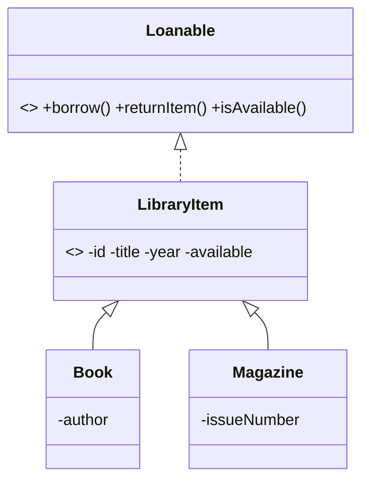
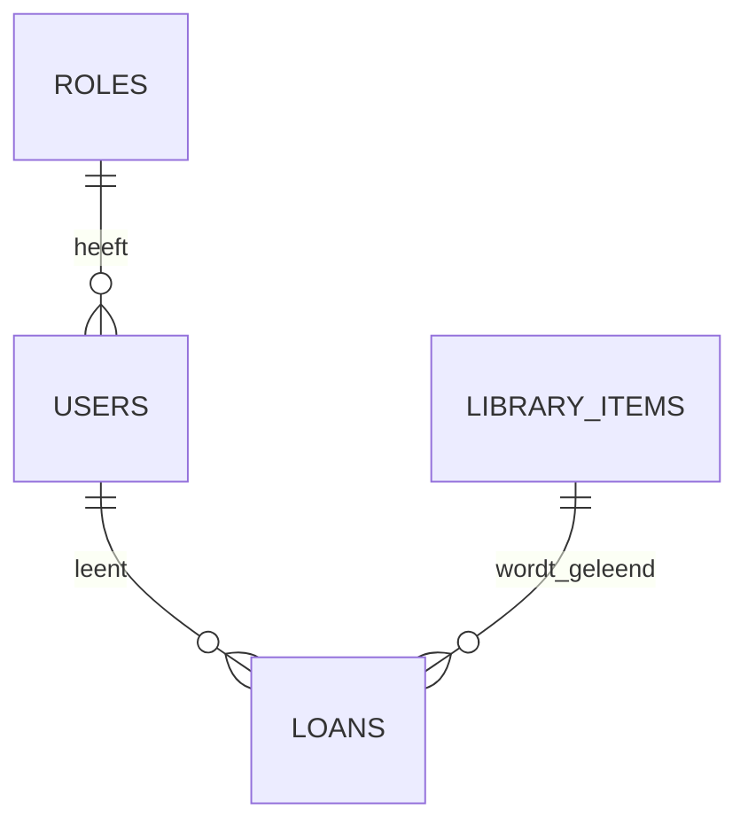

# Library Management System (mini-project)

> Startpakket. De code is niet gecompileerd of getest in mijn omgeving: draai `mvn test` zelf en pas aan waar nodig.

## Wat al staat
- `db/schema.sql` – tabellen users, roles, library_items, loans
- `domain/` – `Loanable` (interface), `LibraryItem` (abstract), `Book`, `Magazine`
- `LibraryItemTest` – eerste unit tests
- `pom.xml` – Jersey, JJWT, Postgres, JUnit

## Ontwerp (UML, Mermaid)

## Jouw taken (de rest van de opdracht)
1. **Ontwerpen**: sequence diagram van `POST /auth/login` en `POST /loans`; use case diagram per rol.
2. **Realiseren**: `User`/`Loan` klassen, DAO/repository met JDBC, `AuthResource` (login → JWT met rol-claim), `ItemResource`, `LoanResource`, een filter dat JWT controleert en rollen afdwingt (STUDENT vs LIBRARIAN), `Application`-klasse met `@ApplicationPath("/api")`.
3. **Frontend** in `src/main/webapp`: login, itemoverzicht, mijn leningen, beheerpagina. Gebruik relatieve URL's.
4. **Testen**: veel unit tests (domein, snel), enkele integratietests op endpoints + autorisatie, hooguit één handmatige end-to-end test. Beschrijf waarom in de piramide.
5. **Manage & Control**: bord met taken + urenschatting, achteraf plan vs. werkelijkheid.
6. **Reflecties**: maandag, woensdag, vrijdag (wat deed ik, wat ging mis, wat leerde ik).

## Endpoints
POST /auth/login · GET /items · GET /items/{id} · POST /items (LIBRARIAN) · PUT /items/{id} (LIBRARIAN) · DELETE /items/{id} (LIBRARIAN) · POST /loans (STUDENT) · PUT /loans/{id}/return (STUDENT) · GET /loans (LIBRARIAN: alle, STUDENT: eigen)

## Presentatie (10 + 5 min)
Casus → leerdoelen → hoe laat je zien dat je dat leerde (ontwerp, tests, reflectie) → demo → vragen.
